# Screenshots

Every page of the dashboard after the layout of 2026-10-25 (a three-tier menu bar, a breadcrumb, at most four key figures
and one main list per page, explanations behind ⓘ), retaken on 2026-10-26 from the code after version 0.2.8, so every
footer shows 0.2.8. Sign-up, which could not be reproduced on the development pod, keeps its screenshot of 2026-10-12
(0.2.6); its template did not change, only the type scale. They were taken on the
development pod (`smarthostctl`) at 1,440 pixels wide unless noted, each page at its full length, signed in as the
administrator (the public pages signed out). The installation is named "Catto Mail" here, the default of `APP_SITE_NAME`.
The figures come from the end-to-end test suites, so the clients, addresses and domains are test data; the overviews show
30 days because the test data is older than the default 7. Every time is in the installation time zone
(`SMARTHOST_TIMEZONE`, here SAST). The development pod is always in HELD mode: live delivery is off and mail goes to Mailpit.

Since 2026-10-27 the menus and buttons use Bootstrap Icons; screenshots taken before that show the earlier drawn icons.
The pages that the guided account setup (2026-10-27, specification 2.13) added or changed were taken again from that
code, so their footers show 0.2.9: the clients list and a client's page, new client, plans, invitations, System setup,
an account's start page, its sending domains and a domain's steps, the pages to make an API key or a webhook endpoint,
the invitation pages, and the two connect pages (taken while the development copy of ctnlist connected through them,
which also shows a ready domain's page with its way back). Their accounts and domains were made for the screenshots (Example Bookshop,
news.example-bookshop.org); a domain's later steps need a real domain's DNS, which the development pod cannot fake.

## Operator console

### The menu bar

`/dashboard/operator/audit` with the System menu open · Pointing at an area opens its pages; a page with an arrow opens
its views, here the audit log's (sign-in emails, sign-ins, sign-up emails …). A number counts what needs a look. Below
1,100 pixels the bar folds behind a *Menu* button.

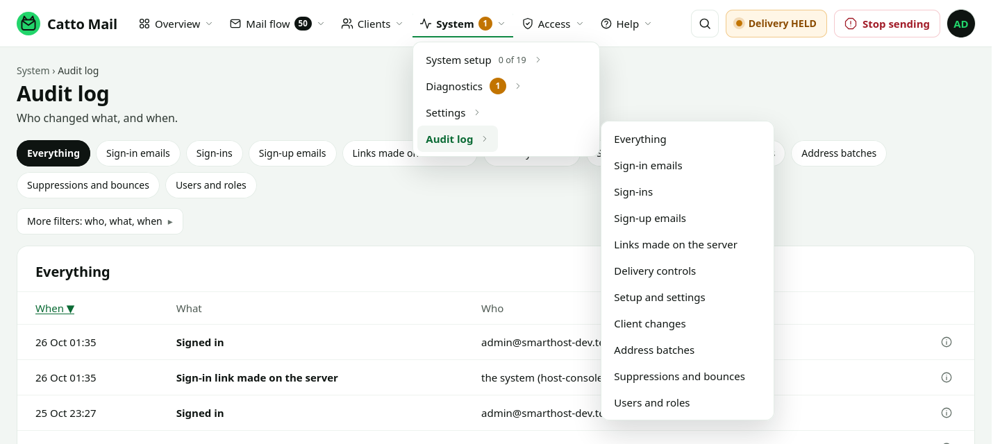

### Overview at 2,560 pixels

`/dashboard/operator?period=30d` · The same page on a wide screen: the content keeps a readable width.

### Overview

`/dashboard/operator?period=30d` · What needs attention, four key figures against the previous period, messages per day, the five clients to watch and system health; the period at the top right.

### Mail flow › Delivery

`/dashboard/operator/system` · The delivery mode with its controls, workers and queues (the Postfix queue among them), the submission rate and the latest host requests.

### Mail flow › Suppressions

`/dashboard/operator/suppressions`

### Mail flow › Unmatched bounces

`/dashboard/operator/unmatched-dsns`

### An unmatched bounce

`/dashboard/operator/unmatched-dsns/{id}`

### Mail flow › Webhooks

`/dashboard/operator/webhooks`

### Clients › Clients

`/dashboard/operator/clients` · *New client* and *Invite someone*, the views as chips with addresses of their own (`/clients/waiting`, `/active`, `/throttled`, `/suspended`, `/closed`, `/invited`, `/sign-ups`), and every client with its status, plan, alerts and domains. How a client came is tagged (invitation, sign-up); the installation's own self-test client is *internal: self-tests*.

### Clients › New client

`/dashboard/operator/clients/new` · One centred page with only what is used: the organisation, the email of the person who manages it (they become its admin and are emailed a sign-in link), the plan, whether they must accept the service policy, and a private note.

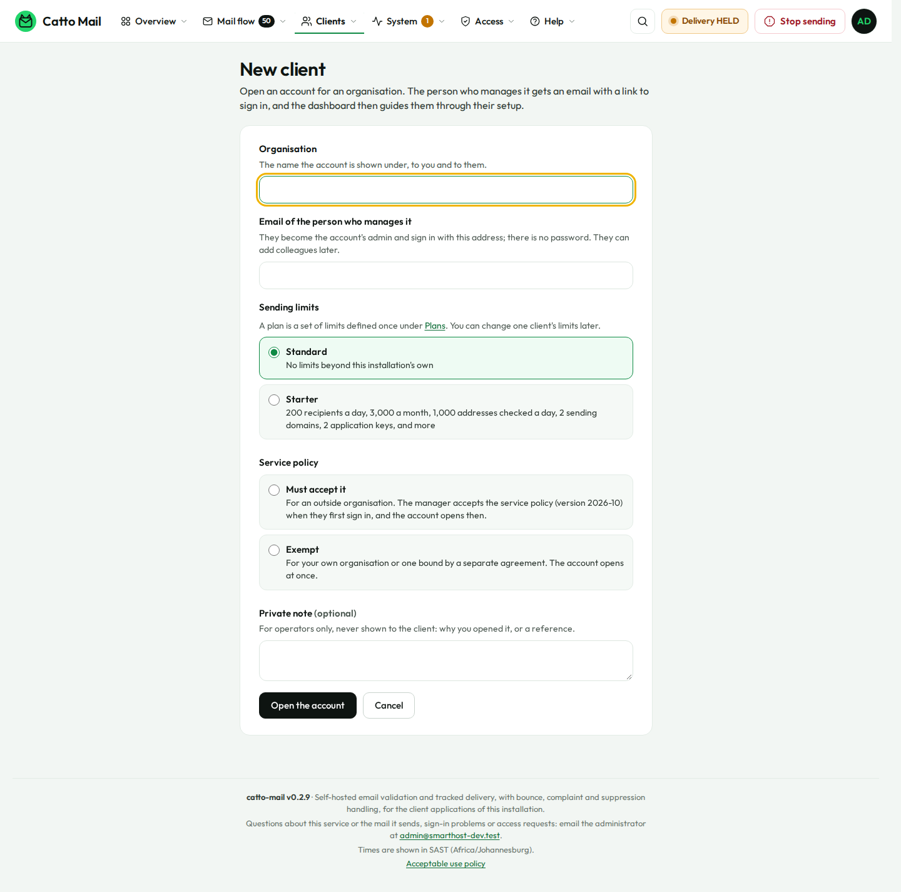

### Clients › Plans

`/dashboard/operator/clients/plans` · Named sets of limits, defined once. Starter and Standard are built in; a client on a plan follows its changes.

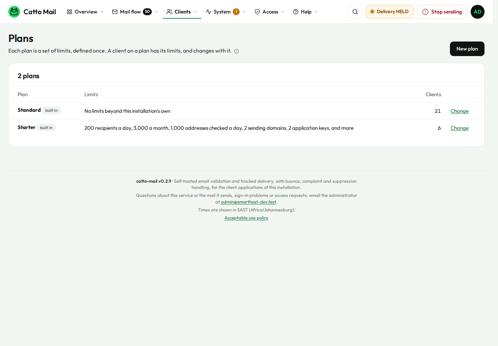

### A plan

`/dashboard/operator/clients/plans/{plan}` · Its name and limits; an installation limit is shown as "at most" beside a field.

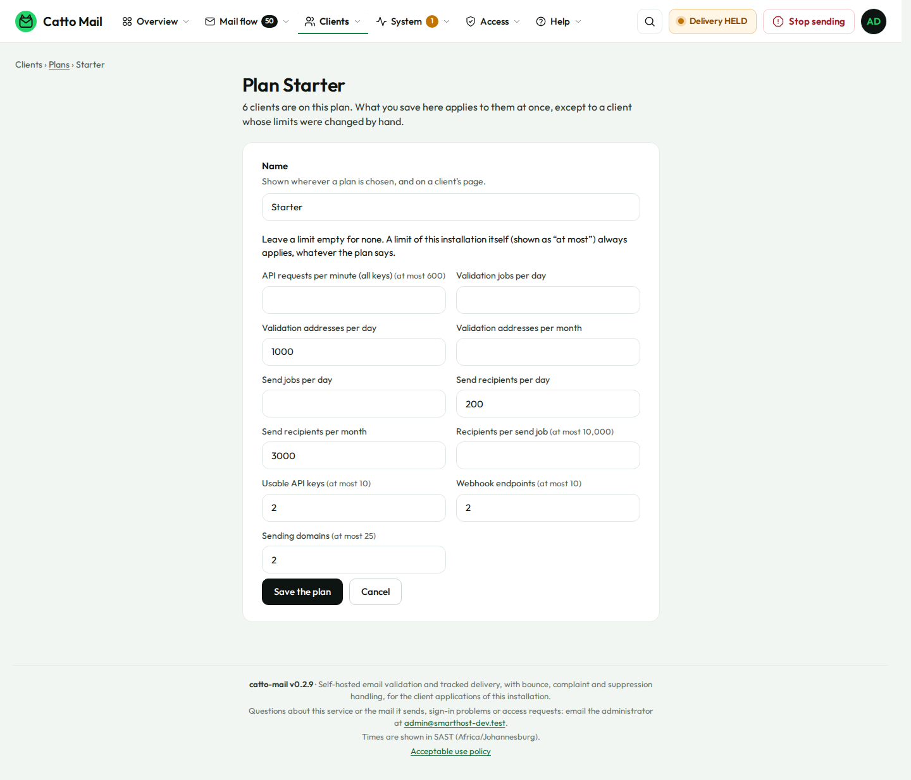

### Clients › Invitations

`/dashboard/operator/clients/invitations` · Every invitation with its state (waiting, used, expired, withdrawn) and *Withdraw* for one not yet used.

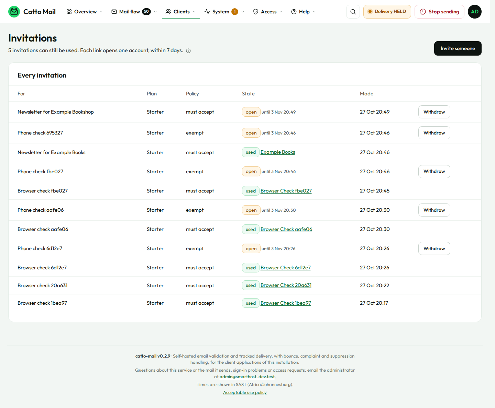

### Invite someone

`/dashboard/operator/clients/invitations/new` · Who it is for (only the operator sees it), the plan and the policy rule.

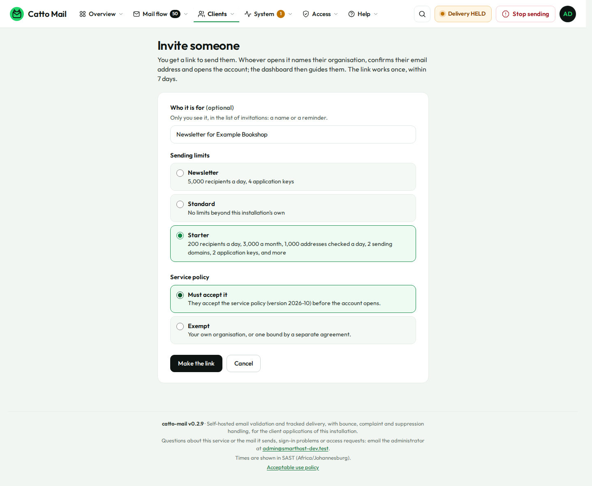

### An invitation's link

After *Make the link* · Shown this once, with a copy button.

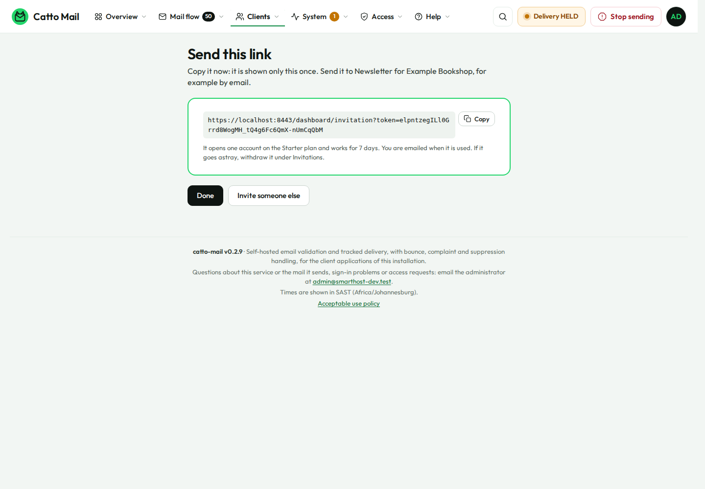

### A client profile

`/dashboard/operator/clients/{id}` · The Summary tab: four key figures, the status with its actions, the account (who manages it, its plan, the client id with a copy button, *Rename*) and private notes. The other tabs hold limits and usage, reputation, domains and webhooks, keys and members, the policy and opt-outs, and the history.

### A client profile: Limits & usage

`/dashboard/operator/clients/{id}?tab=limits`

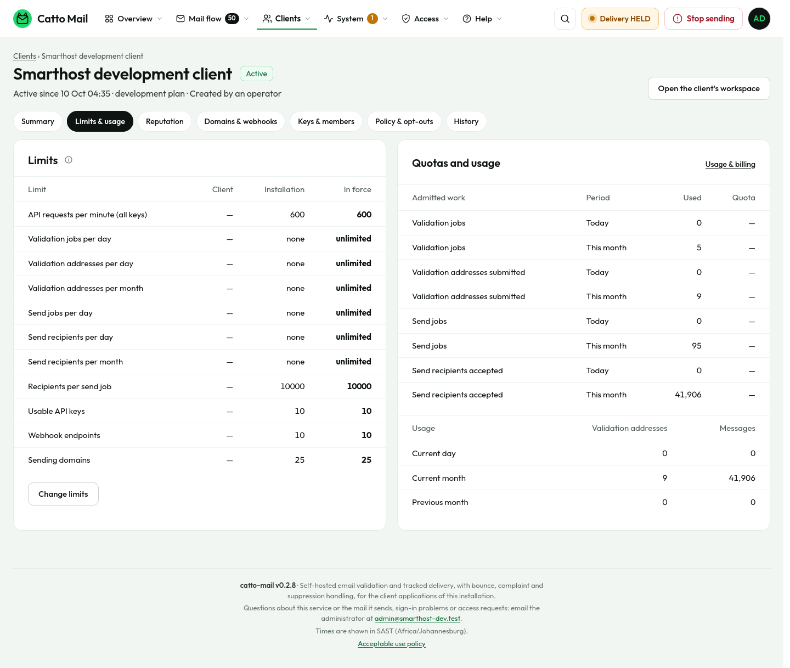

### Clients › Abuse & reputation

`/dashboard/operator/alerts`

### Clients › Usage & billing

`/dashboard/operator/usage`

### Clients › Address batches

`/dashboard/operator/batches`

### System › System setup

`/dashboard/operator/setup` · First the six steps that need the administrator (DNS, backups, the seed, bounce and reboot tests, readiness), then the steps the system checks by itself, of which only those that need a look are open; *Continue* goes to the next step that needs the administrator.

### System setup: the DNS step

`/dashboard/operator/setup/dns` · The step's records and checks, the previous and next step, and its state.

### System › Diagnostics

`/dashboard/operator/system/diagnostics`

### System › Settings

`/dashboard/operator/system/settings` · One group of operational settings at a time, chosen in the menu or from the chips.

### Host requests

`/dashboard/operator/system/requests`

### System › Audit log

`/dashboard/operator/audit` · Views as chips (sign-in emails, sign-ins, …) and the full filter form under *More filters*; each entry's details behind ⓘ.

### Access › Users

`/dashboard/operator/users`

### A user

`/dashboard/operator/users/{id}`

### Access › Roles & permissions

`/dashboard/operator/roles`

### A role

`/dashboard/operator/roles/{id}`

### Help

`/dashboard/operator/help`

### A help topic (DNS)

`/dashboard/operator/help/dns`

### Search

`/dashboard/search?q=smarthost` · The search button at the top right; results are grouped by kind.

## A client's account

What a client's own users see (an operator sees it too, under a banner). Its screens say *account*.

### Overview

`/dashboard/c/{client}?period=30d` · An account whose setup is done: the state and the limits in one line, four key figures, the latest send jobs and one status per sending domain (here opened by an operator).

### A new account's start page

`/dashboard/c/{client}` · *Get ready to send* until every step is done: accept the service policy (when required), make a sending domain ready, connect an application (a key and a webhook made by hand count, under "For developers"), send a test message. The current step has its button.

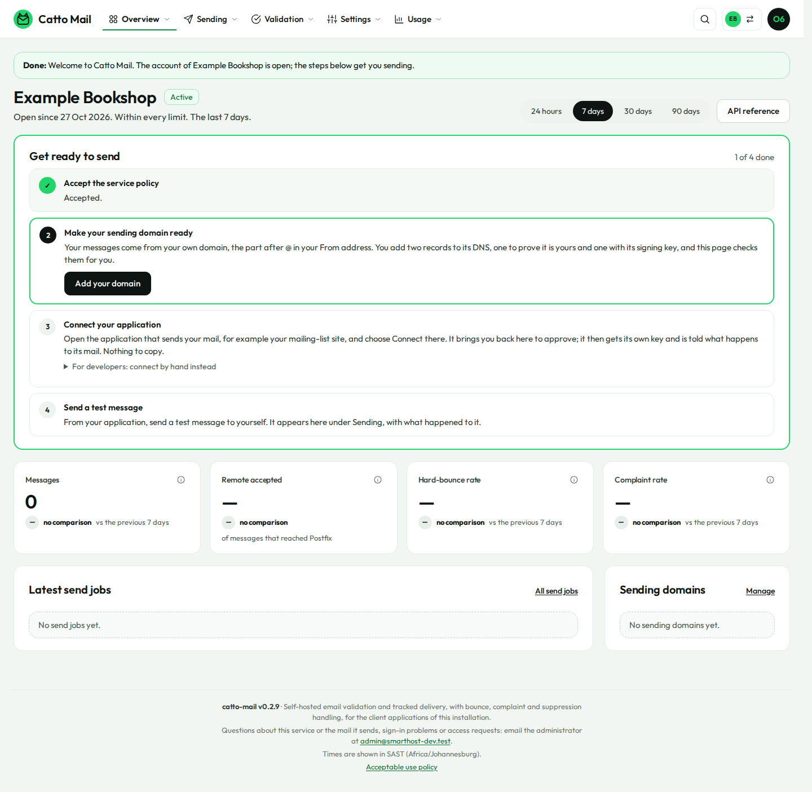

### Sending › Send jobs

`/dashboard/c/{client}/send-jobs`

### A send job

`/dashboard/c/{client}/send-jobs/{id}` · The 10,000-recipient end-to-end test job.

### A message timeline

`/dashboard/c/{client}/messages/{id}`

### Sending › Suppressions

`/dashboard/c/{client}/suppressions` · The account's own blocks, the operator's blocks of it and the opt-outs it reported, each with *Lift* where the account may lift it; *Block an address or a domain*; a search that also finds an address's domain block (here an account block made from ctnlist's Actions menu, opened by an operator).

### Block an address or a domain

`/dashboard/c/{client}/suppressions/new` · One field: an address, or a domain for every address at exactly that domain.

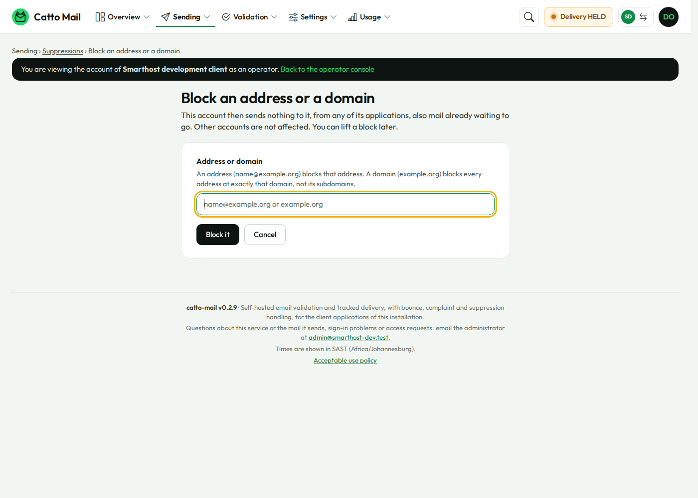

### Validation › Validation jobs

`/dashboard/c/{client}/validation-jobs`

### A validation job

`/dashboard/c/{client}/validation-jobs/{id}`

### Settings › Sending domains

`/dashboard/c/{client}/sending-domains` · Every domain with the step it is at and when it was last looked at; *Add a domain* within the account's limit.

### Add a domain

`/dashboard/c/{client}/sending-domains/new` · The domain only; the next page shows its first step.

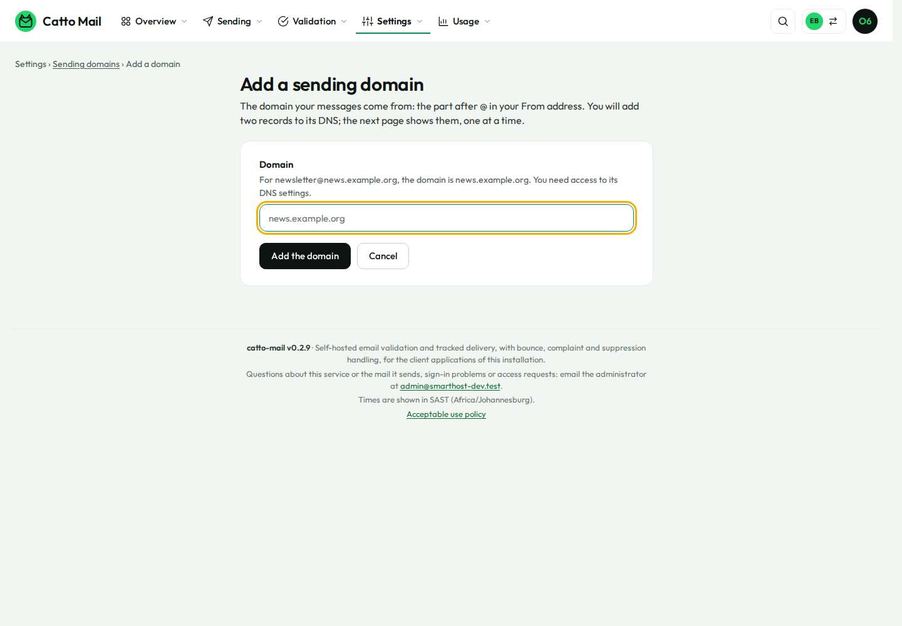

### A domain's steps

`/dashboard/c/{client}/sending-domains/{domain}` · One step at a time (prove it is yours, publish its signing key, ready to send), each record with copy buttons and a sentence on what it is for. The page looks at DNS every 30 seconds and moves on by itself; *Check now* looks at once; the account's admins are emailed when the domain is ready. An application that sent the person here gets a *Back to* link.

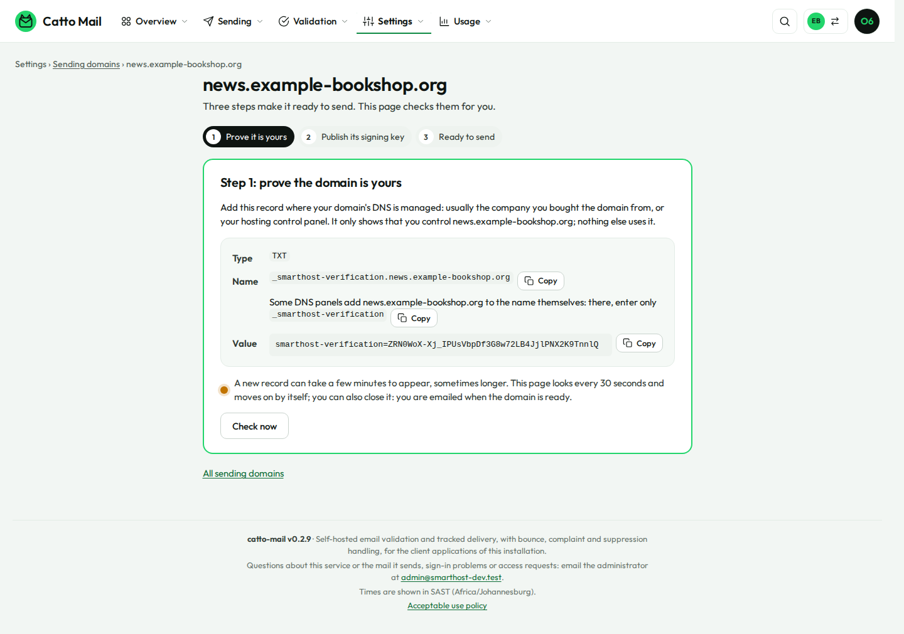

### A domain ready, opened from an application

`/dashboard/c/{client}/sending-domains/{domain}?back=…` · All three steps done, a DMARC record suggested (or the existing one recognised), the SPF line, and *Back to ctnlist*: the application that sent the person here, whose address is on the origin of one of the account's connections (here opened by an operator, so with the operator's banner).

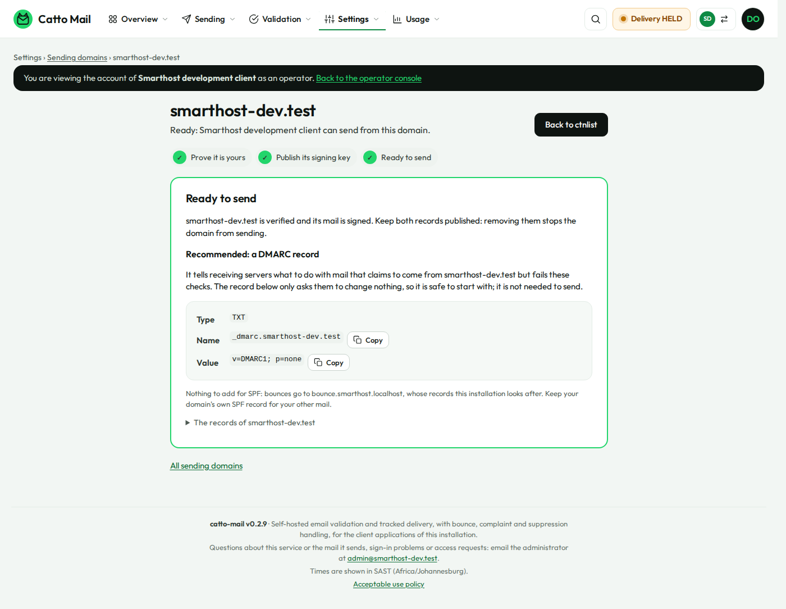

### Settings › API keys

`/dashboard/c/{client}/api-keys`

### Make an API key

`/dashboard/c/{client}/api-keys/new` · Its own page; the key is then shown once, with a copy button.

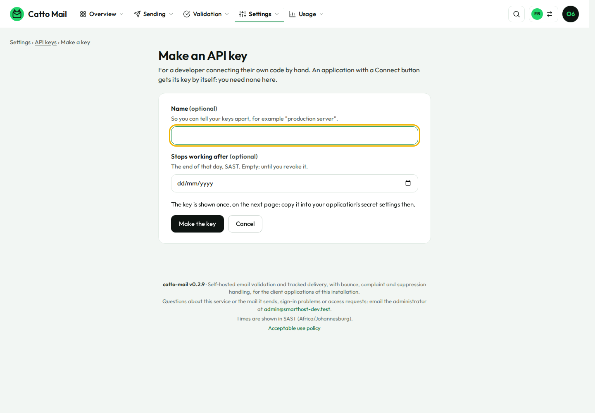

### Settings › Webhooks

`/dashboard/c/{client}/webhooks`

### Add a webhook endpoint

`/dashboard/c/{client}/webhooks/new` · Its own page; the signing secret is then shown once, with a copy button.

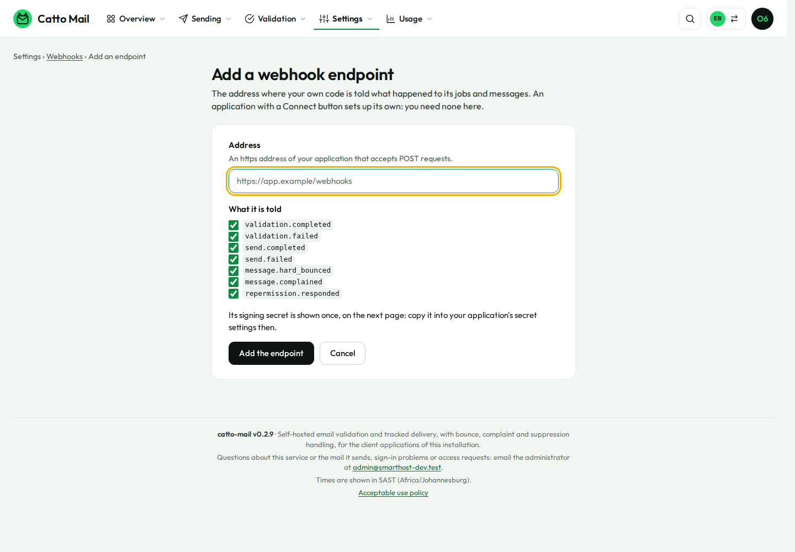

### Settings › Connected applications

`/dashboard/c/{client}/connections` · The applications a client admin connected from the connect page: where each one's
webhooks go, its API key's prefix and last use, who approved it, and *Disconnect*, which revokes the key and removes the
endpoint. An ended connection stays in the list.

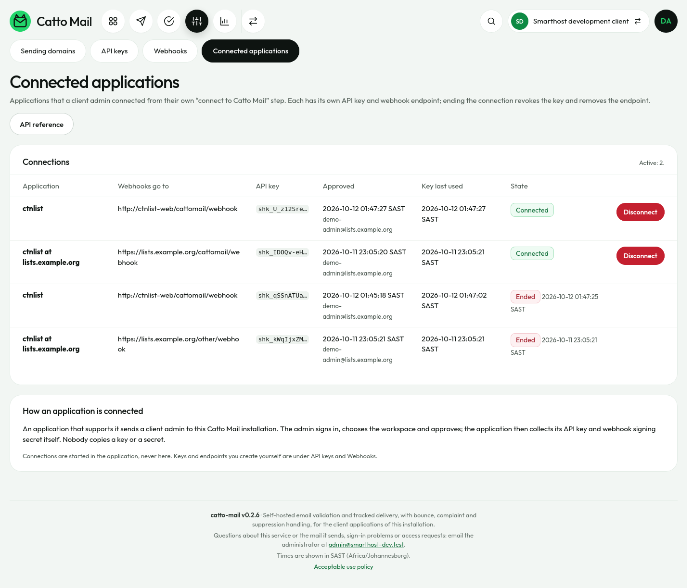

### Connect an application: the approval

`/dashboard/connect?…` signed in · What the application asks for (here also the domain it sends from), the account to connect (with
what happens to that domain there), *Connect* and *Cancel*, and what connecting does.

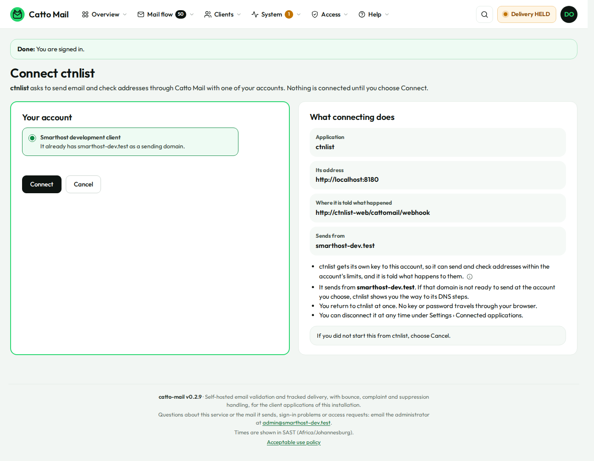

### Usage & limits

`/dashboard/c/{client}/usage`

## Public pages

### Front page

`/` · What someone who types the installation's address sees: sign-in, the API documentation and a word for recipients of
its mail. A full-width banner over four quarter cards.

### Sign up

`/dashboard/sign-up` · Only when the operator turns public sign-up on (`APP_PUBLIC_ONBOARDING_ENABLED=true`; otherwise 404). An organisation and an email address; the confirmation link arrives by email, and the account opens on the Starter plan when it is used.

### An invitation

`/dashboard/invitation?token=…` · The link an operator made: the organisation and an email address; the confirmation link arrives by email. It works also while public sign-up is off.

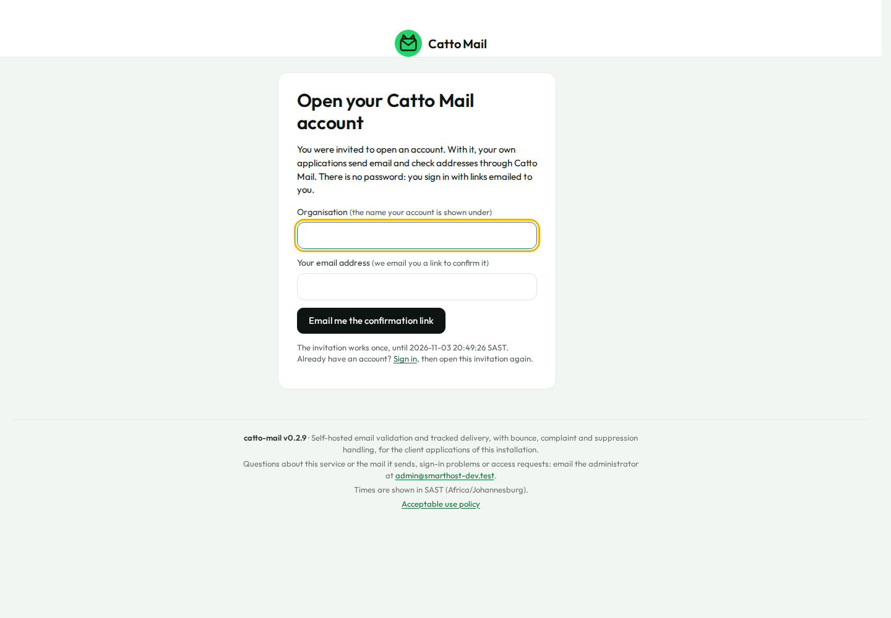

### An invitation: open the account

`/dashboard/invitation/confirm?token=…` · From the emailed link: the organisation, the address that signs in, what opening does, and the service policy when the invitation requires it.

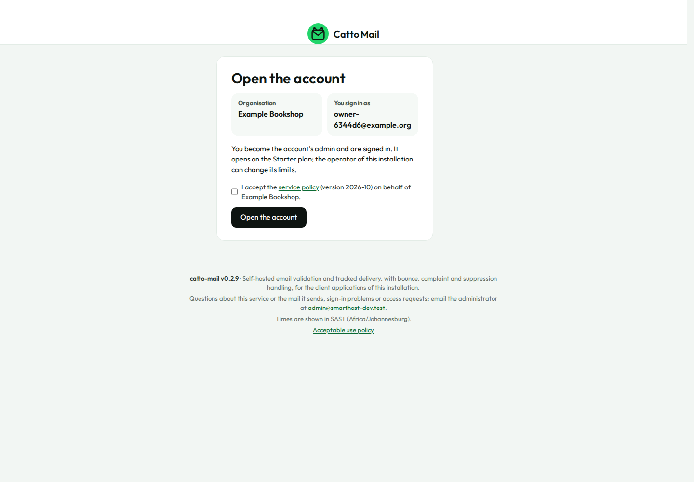

### Sign in

`/dashboard/login` · Passwordless: the link arrives by email.

### Connect an application: a visitor

`/dashboard/connect?…` · Where an application sends a person to be connected: what is asked, and sign-in. *Create an
account* is offered beside it only while public sign-up is on; otherwise the page says accounts are opened by invitation. Nothing is connected before a client admin approves.

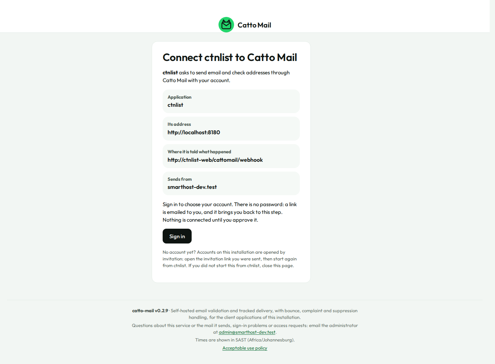

### Acceptable use policy

`/acceptable-use-policy` · Built from `docs/AUP.md`; every page's footer links to it. The document names no product: the page fills in the installation's name, its domain (here `localhost`) and who runs it from the configuration. Abuse reports go to `abuse@` that domain, the only address on the page: the footer here leaves the administrator's address out.

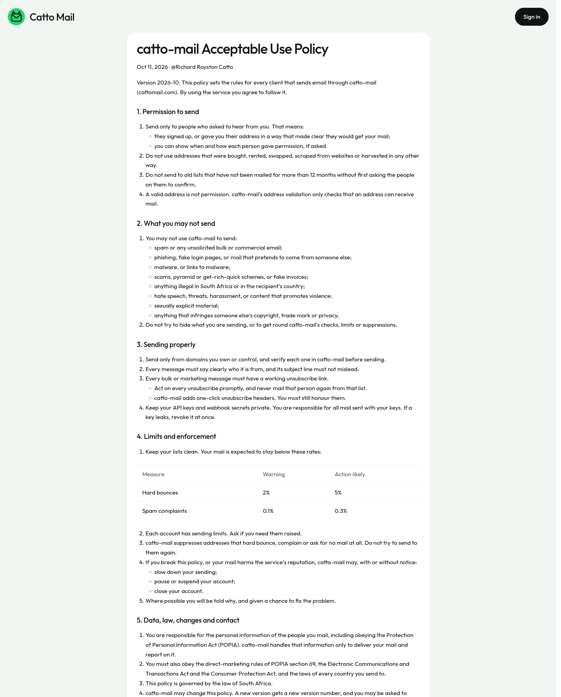

### API documentation

`/docs/api`

### Error page (404)

`any unknown path` · Taken from Symfony's error preview (`/_error/404`), because the development pod shows its debug page
instead.

## Phone width (390 pixels)

### Front page

`/` · The four cards stack in one column.

### Operator overview

`/dashboard/operator?period=30d` · The menu bar folds behind *Menu*; the cards fall to one column and wide tables scroll
inside their cards.

### Mail flow › Delivery

`/dashboard/operator/system`

### Clients › Clients

`/dashboard/operator/clients`

### Client overview

`/dashboard/c/{client}?period=30d`

### Sending › Send jobs

`/dashboard/c/{client}/send-jobs`

### A new account's start page

`/dashboard/c/{client}` · The checklist's steps in one column; buttons wrap.

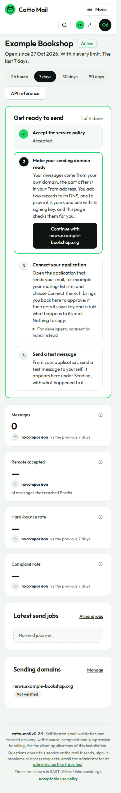

### A domain's steps

`/dashboard/c/{client}/sending-domains/{domain}` · The records and their copy buttons wrap within the screen.

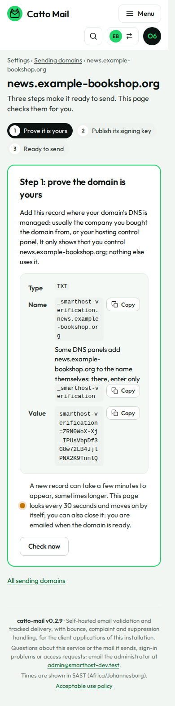

### Clients › New client

`/dashboard/operator/clients/new`

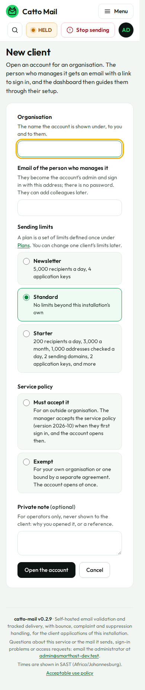

### System › System setup

`/dashboard/operator/setup` · Long check results wrap instead of widening the page.

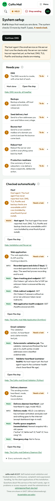

### An invitation

`/dashboard/invitation?token=…`

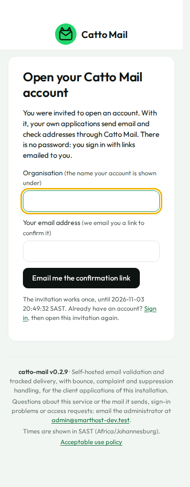
